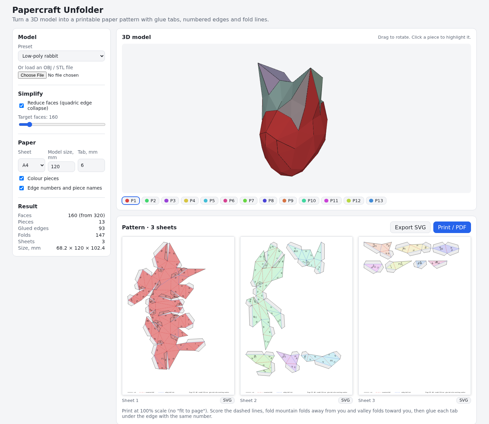

# Papercraft Unfolder

Turn a 3D model into a paper model you can print and glue. Load an OBJ or STL file (or pick a preset), reduce it to a buildable number of faces, and the tool unfolds it into flat, non-overlapping pieces with glue tabs, matching edge numbers and mountain and valley fold lines, packed onto A4 or Letter sheets.

**Try it: [hermes98761234.github.io/papercraft-unfolder](https://hermes98761234.github.io/papercraft-unfolder/)**

[](https://github.com/hermes98761234/papercraft-unfolder/actions/workflows/deploy.yml)



## Features

- **OBJ and STL input**, including binary STL, quads and negative OBJ indices. Or start from a preset: cube, icosahedron, cylinder, cone, sphere (chosen resolution) or a procedural low-poly rabbit.
- **Mesh decimation** to a target face count by quadric edge collapse, so dense scans become buildable. Closed meshes stay closed.
- **Smart cutting.** Flat edges stay folded and sharp edges are cut first. Pieces are split automatically when a net would overlap itself or would not fit on a sheet.
- **Glue tabs and numbers.** Every cut edge gets exactly one trapezoid tab and the same number on both sides.
- **Fold lines.** Mountain folds are dash-dot red, valley folds are dashed blue.
- **3D view** with faces coloured by piece. Click a piece in 3D, in the chip list or on a sheet to highlight it everywhere.
- **Export** the sheets as one SVG, one SVG per sheet, or print (and save as PDF) at true size through the browser's print dialog.
- Real model size in millimetres, tab width, A4 or Letter, light and dark theme. Settings are remembered. Everything runs in your browser, the heavy work in a Web Worker.

## How it works

1. **Dual graph and fold-angle weights.** Faces are nodes and shared edges are arcs. Each arc is weighted by the cosine of the dihedral angle. A maximum spanning tree (Kruskal) keeps the flattest edges folded, so cuts fall along the sharpest edges.
2. **Unfolding.** Faces are laid out in the plane along the tree. Each new triangle is placed across its parent's shared edge from its three side lengths, so edge lengths and areas are preserved exactly.
3. **Overlap handling.** Each placed triangle is tested against its piece with a 2D separating-axis test. If it overlaps, or the piece would outgrow the sheet, that tree edge is cut and the triangle starts a new piece.
4. **Tabs.** A trapezoid tab goes on one side of every cut edge, on whichever side collides with nothing in its piece.
5. **Packing.** Each piece is rotated to its minimum-area bounding box (a hull edge is flush) and the pieces are packed onto sheets with a shelf algorithm.
6. **Decimation** follows Garland and Heckbert, "Surface Simplification Using Quadric Error Metrics", SIGGRAPH 1997, with a link condition and a normal-flip check.

Spanning-tree unfolding of polyhedra is the approach described in Straub and Prautzsch, "Creating Folding Patterns for Polyhedra", and used by tools such as Pepakura. The tests check the invariants: edge lengths and areas survive unfolding, no two faces overlap on a sheet, and every cut edge has exactly one tab and two matching labels.

## Quick start

You need [Node.js](https://nodejs.org/) 22.

```bash
git clone https://github.com/hermes98761234/papercraft-unfolder.git
cd papercraft-unfolder
npm install
npm run dev       # http://localhost:5173
npm test          # parsers, decimation, unfolding, tabs, packing
npm run build     # static site in dist/
```

## License

MIT.
